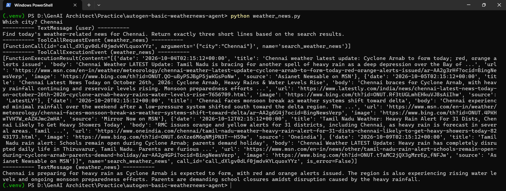

# AutoGen Basic Weather News Agent

A simple AI agent built with Microsoft's AutoGen framework that searches for weather-related news for a given city and summarizes the results in three short lines.

## Features

- Accepts a city name through terminal input.
- Searches weather-related news using DuckDuckGo.
- Uses an AutoGen agent with a custom search tool.
- Summarizes search results using OpenAI's `gpt-4o-mini` model.

## Technologies Used

- Python
- Microsoft AutoGen
- OpenAI API
- DuckDuckGo Search (`ddgs`)

## Project Structure

```text
autogen-basic-weathernews-agent/
├── screenshots/
│   └── demo.png
├── .env
├── .gitignore
├── README.md
├── requirements.txt
└── weather_news.py
```

## Setup

### 1. Create a virtual environment

```powershell
python -m venv .venv
.\.venv\Scripts\Activate.ps1
```

### 2. Install dependencies

```powershell
pip install -r requirements.txt
```

### 3. Configure the API key

Create a `.env` file in the project root:

```env
OPENAI_API_KEY=your_openai_api_key
```

Replace the placeholder with your OpenAI API key.

### 4. Run the application

```powershell
python weather_news.py
```

Enter a city when prompted. The agent searches for related weather news and generates a short summary.

## Demo



## Notes

- DuckDuckGo search does not require a separate search API key.
- An OpenAI API key is required to generate the summary.
- Search results depend on the availability and freshness of indexed news articles.